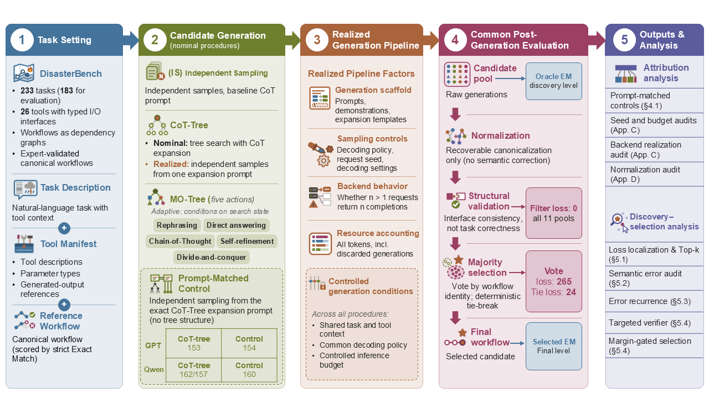
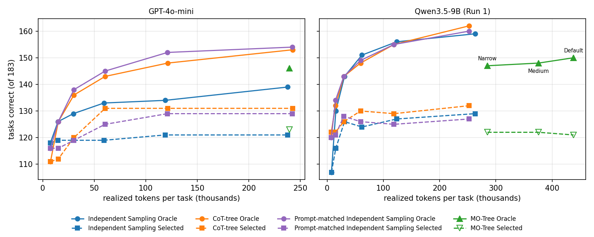
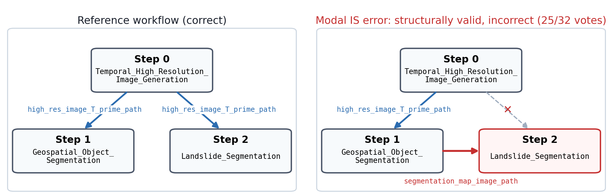

# Found but Not Chosen: Attribution and Selection in Structured Workflow Planning on DisasterBench

Code, candidate pools, cached LLM decisions and analysis scripts for the paper. Every number, table and figure of
the paper can be regenerated offline from the released candidate pools with one command, and is then checked
automatically against the values printed in the paper.

The study compares Best-of-N (BoN), a chain-of-thought tree (CoT-tree), a multi-operator tree (MO-Tree) and a
prompt-matched BoN control on GPT-4o-mini and Qwen3.5-9B, on the 183-task DisasterBench evaluation split, and
separates *finding* a correct workflow (Oracle EM) from *choosing* it (Selected EM).

<p align="center">
  
</p>

**Overview.** Candidate pools are generated by BoN, CoT-tree, MO-Tree and a prompt-matched BoN control, then pass
through a common post-generation evaluation (normalization, structural validation, majority selection). Oracle EM
measures whether a pool contains a correct workflow; Selected EM whether the final selected workflow is correct.
Main numbers and figures: [Results](#results).


## Repository Structure

```text
.
├── main.py                 # Candidate generation entry point
├── src/                    # Core planning and OpenRouter-compatible client
├── baselines/              # BoN, CoT-tree, and MO-Tree implementations
├── scripts/                # Post-processing, selection, audits, and figures
│   └── reproduce_all.sh    # One-command offline reproduction
├── data/                   # Task IDs and benchmark splits
├── artifacts/              # Manifests, cached decisions, audits, and results
├── prompts/                # Judge, verifier, and audit prompts
├── assets/                 # README figures
├── third_party/            # Pinned DisasterBench_Open
│
├── runs/                   # Raw candidate pools [data package]
└── logs/                   # Per-request logs [data package]
```

The separate data package additionally provides:
- `artifacts/**/run/`: Raw prompt-matched BoN pools.
- `artifacts/**/per_candidate.jsonl` and `*_per_candidate.csv`: Candidate-level evaluation results.
- `logs/`: Sampling parameters, finish reasons, and token usage; no prompts or completions. Response IDs are replaced with truncated SHA-256 hashes.


## Setup

Python 3.12.

```bash
pip install -r requirements.txt
python scripts/prepare_disasterbench.py
```

`prepare_disasterbench.py` sets up DisasterBench_Open (MIT) at commit
`408672bf0da489d94e6245900a87ec913b3d69f9`, verifies the sha256 of the benchmark, evaluator and tool manifest,
writes the split used in the paper (`data/train.jsonl`: public task ids 1-50; `data/test.jsonl`: public ids
51-233, renumbered 1-183) and checks the split hashes, and copies the tool manifest into `src/interfaces/tools/`.
The pinned DisasterBench_Open files are included under `third_party/DisasterBench_Open/` with their license.

### Evaluator

Exact Match (`check_answers_equivalence`) and the Tool / Parameter / Dependency checks come unchanged from the
pinned DisasterBench evaluator (`src/evaluators/evaluators.py` loads it). Answer extraction from a raw completion
(`isolate_answer`, `extract_answer_from_model_completion`) is the version that produced the stored `model_answer`
of every candidate pool; the pinned upstream extraction is more lenient and parses a few dozen raw completions
differently, so the shim keeps the original extraction for generation and for the offline re-extraction steps.

## Data

The raw candidate pools, request logs and candidate-level evaluation results are distributed separately from the
code.

Download `found-but-not-chosen-data-anon.zip` from the supplementary material of the submission and extract it into
the repository root before running the reproduction scripts (it adds `runs/`, `logs/`, the raw prompt-matched pools
and the candidate-level result files).

## Reproducing the paper

```bash
bash scripts/reproduce_all.sh
```

The script runs offline (about 16 minutes on a shared Linux server; no GPU needed):

1. rebuilds every evaluated candidate bundle from the raw pools (strict post-processing, hard0 structural filter,
   exact-JSON majority vote, tie broken by the smallest `candidate_id`);
2. bundle diagnostics and the GPT-4o judge;
3. seed sensitivity (no-seed vs fixed-seed GPT-4o-mini);
4. the targeted Top-3 verifier and the deployable Top-3 selector;
5. all remaining analyses, tables and figures (`scripts/run_final_primary_offline.sh`), the historical tables, and
   the audit tallies;
6. `scripts/check_paper_numbers.py`, which compares every table, the Figure 1 panels and the key statistics of the
   text with the regenerated files (`artifacts/final_primary/paper_check.csv`) and fails on any mismatch.

GPT-4o decisions (judge, Top-3 verifier, Top-3 selector) are replayed from the released caches
(`artifacts/**/cache*.json`): the script sets a placeholder API key and an unreachable base URL, so a cache miss
fails instead of calling an API. The `usage.json` files written by these steps therefore report zero API calls and
zero cost. `SOURCE_DATE_EPOCH` is set so that the PDF figures are byte-reproducible; PNG figures can differ at the
pixel level with other matplotlib / FreeType builds.

The protocol of the final results: no request seed; E2b (multi-predecessor dependency reduction) and E4
(manifest-assisted output-key correction) disabled (`--keep_multi_pred`); hard0 filter; exact-JSON majority over
normalized workflows (BoN: one vote per call; tree pools: one vote per distinct solution text); ties to the smallest
`candidate_id`. Eleven pools are analysed: 9 primary pools (GPT-4o-mini and Qwen3.5-9B Run 1 / Run 2 x BoN,
CoT-tree, MO-Tree) plus the GPT-4o-mini and Qwen prompt-matched BoN controls.

### Where each result comes from

| Paper | Script(s) | Result files (under `artifacts/`) |
|---|---|---|
| Tab. main results; Tab. pool statistics | `freeze_strict_matched.py`, `analyze_pool_concentration.py`, `eval_prompt_matched_bon.py` | `mini_noseed_trees_full/eval_e2b_off/`, `e2b_off_primary/qwen_b{1,2}/` (`summary.csv`, `per_task.csv`), `final_primary/concentration/summary.csv`, `prompt_matched_bon/eval/`, `prompt_matched_bon_qwen/eval_vs_b{1,2}/` |
| Fig. 1 panels (attribution, validation, loss localization 289 = 0 + 265 + 24, Top-k, diversity) | `build_fig1_panels.py` | `final_primary/fig1/` |
| Fig. budget scaling (main, appendix); Fig. candidate subsampling | `analyze_budget_curve.py`, `plot_budget_curve.py` | `final_primary/budget_curve/` |
| Tab. generation configurations | `generation_command.py` | `runs/**/config.json` (repository root, not under `artifacts/`) |
| Tab. paired tests | `freeze_strict_matched.py`, `eval_prompt_matched_bon.py` | `paired_ci.csv` in each bundle directory above |
| Tab. run-level prompt-matched sensitivity | `eval_prompt_matched_bon.py` | `prompt_matched_bon*/eval*/summary.csv` |
| Tab. seed sensitivity; Tab. E2b audit | `analyze_noseed_bon.py`, `analyze_noseed_trees.py` | `mini_noseed_bon_full/no_seed_bon_summary.csv`, `mini_noseed_trees_full/noseed_trees_summary.csv` |
| Tab. transformation inventory | `audit_transformations_final.py` | `final_primary/transformation_audit/` |
| Tab. normalization (fixed-seed pools); pooled token accounting | `audit_historical_tables.py` | `final_primary/historical/` |
| Normalization EM flips (1,612 incorrect-to-correct, 0 correct-to-incorrect) | `audit_normalization_em_flips.py` | `final_primary/normalization_em_flips/` |
| Tab. calibration-task exclusion | `freeze_strict_matched.py --exclude_ids_file` | `final_primary/excl_calib5_178/` |
| Tab. Qwen MO-Tree width | `freeze_strict_matched.py` (breadth manifests) | `final_primary/breadth/{medium,orig}/` |
| Tab. Top-k selection; Tab. vote margins | `analyze_vote_rank.py` | `final_primary/vote_rank/` |
| Tab. semantic audit; representative errors | `tally_vote_loss_audit.py` | `vote_loss_audit_final/` |
| Tab. partial credit by rank / margin | `analyze_voteloss_partial_credit.py`, `audit_partial_credit_definition.py` | `final_primary/voteloss_partial_credit/`, `final_primary/partial_credit_definition/` |
| Tab. modal-error agreement | `analyze_selection_rebuild.py`, `analyze_modal_errors.py` | `selection_rebuild/` |
| Tab. selector sensitivity; Tab. GPT-4o judge | `build_final_primary.py`, `run_locked_judge.py`, `audit_judge_truncation.py` | `final_primary/selector_sensitivity.csv`, `final_primary/judge*`, `e2b_off_primary/judge/` |
| Tab. targeted Top-3 verifier (90 fixes / 175 false overrides) | `run_top3_verifier.py`, `run_top3_selector.py` | `final_primary/top3_verifier/`, `final_primary/top3_selector/` |
| Tab. changed decisions; Tab. margin bins | `analyze_verifier_failure_modes.py` | `final_primary/verifier_failure_modes/` |
| Tab. margin-gated verifier | `analyze_margin_gated_selector.py` | `final_primary/margin_gated/` |
| Fig. / Tab. Task 22 | `plot_task22_workflow.py`, `analyze_task22_votes.py` | `final_primary/figures/`, `final_primary/task22_votes.csv` |
| Backend sampling facts (GPT-4o-mini n>1 returns one choice, tie-break calls, thinking-mode CoT) | `audit_backend_sampling.py` | `final_primary/backend_sampling/` |
| Consistency assertions across the above | `audit_final_consistency.py`, `audit_validator_dependency_checks.py` | `final_primary/consistency_audit.log`, `final_primary/validator_dependency_audit/` |

`artifacts/final_primary/PROVENANCE.md` documents the provenance of the reported results, including corrections
made during manuscript preparation.

### Winner-vs-gold audit

The 60-case audit was labelled by an LLM annotator with a fixed rubric (`prompts/vote_loss_annotation.md`) and
reviewed by three human reviewers, each of whom confirmed the primary error category and the semantic-equivalence
label of all 60 cases. The final per-case labels are in `artifacts/vote_loss_audit_final/audit_sample_final.csv`;
`human_review_summary.csv` and `human_review_per_case.csv` in the same directory summarize the review (reviewers anonymized; the raw
review sheets are not released).

## Generating new pools

Install the generation dependencies (`pip install -r requirements-generation.txt`) and copy `.env.example` to
`.env`. The exact `main.py` command of every released run is recovered from its configuration:

```bash
python scripts/generation_command.py runs/gpt-4o-mini/no_seed/cot_tree/config.json
```

Backend switches are environment variables of the OpenRouter-compatible client and are not part of `config.json`:

- final protocol, no request seed: `OPENROUTER_SEND_SEED=0` (the `--seed` argument still seeds local sampling of the
  search); the fixed-seed GPT-4o-mini runs sent seed 20260808;
- Qwen3.5-9B non-thinking: `OPENROUTER_BASE_URL=http://127.0.0.1:8000/v1`, `OPENROUTER_ENABLE_THINKING=0`,
  served with vLLM 0.30.0 from the Hugging Face snapshot `c202236235762e1c871ad0ccb60c8ee5ba337b9a`:

```bash
vllm serve Qwen/Qwen3.5-9B --served-model-name local/qwen3.5-9b-nothink local/qwen3.5-9b-vllm \
  --port 8000 --host 127.0.0.1 --max-model-len 16384 --gpu-memory-utilization 0.90 \
  --reasoning-parser qwen3 --enable-prefix-caching --seed 0
```

(restarts used `VLLM_USE_FLASHINFER_SAMPLER=0`; the Qwen prompt-matched control used
`--gpu-memory-utilization 0.60`, which only changes KV-cache capacity). The prompt-matched controls are generated
with `scripts/run_prompt_matched_bon.py` (configurations in `artifacts/prompt_matched_bon*/run/config.json`). New
GPT-4o judge / verifier decisions require `OPENROUTER_API_KEY` and are cached next to the existing ones. LLM sampling
through hosted APIs is not bit-reproducible, so regenerated pools will differ from the released ones; the released
pools are the basis of every number in the paper.

## Results

All numbers below are regenerated by `scripts/reproduce_all.sh` and checked against the paper by
`scripts/check_paper_numbers.py`.

### Main results

Correct tasks out of 183 (%, in parentheses). Gap = Oracle - Selected = vote loss + tie loss; the structural
filter loses no task in any pool.

| Model / run | Method | Oracle EM | Selected EM | Gap | Vote loss | Tie loss | Tokens / task |
|---|---|---|---|---|---|---|---|
| GPT-4o-mini | BoN | 139 (76.0) | 121 (66.1) | 18 | 18 | 0 | 238k |
| GPT-4o-mini | CoT-tree | 153 (83.6) | 131 (71.6) | 22 | 22 | 0 | 242k |
| GPT-4o-mini | MO-Tree | 146 (79.8) | 123 (67.2) | 23 | 21 | 2 | 239k |
| GPT-4o-mini | Prompt-matched BoN | 154 (84.2) | 129 (70.5) | 25 | 24 | 1 | 242k |
| Qwen3.5-9B Run 1 | BoN | 159 (86.9) | 129 (70.5) | 30 | 28 | 2 | 263k |
| Qwen3.5-9B Run 1 | CoT-tree | 162 (88.5) | 132 (72.1) | 30 | 28 | 2 | 253k |
| Qwen3.5-9B Run 1 | MO-Tree | 147 (80.3) | 122 (66.7) | 25 | 19 | 6 | 285k |
| Qwen3.5-9B Run 2 | BoN | 162 (88.5) | 128 (69.9) | 34 | 33 | 1 | 263k |
| Qwen3.5-9B Run 2 | CoT-tree | 157 (85.8) | 133 (72.7) | 24 | 22 | 2 | 252k |
| Qwen3.5-9B Run 2 | MO-Tree | 147 (80.3) | 122 (66.7) | 25 | 18 | 7 | 284k |
| Qwen3.5-9B control | Prompt-matched BoN | 160 (87.4) | 127 (69.4) | 33 | 32 | 1 | 253k |

Over the 9 primary pools, a deployable GPT-4o Top-3 verifier fixes 90 majority-vote errors but overrides 175
correct majority choices, so Selected EM drops from 1,141 to 1,056 correct pool-tasks.

### Where the gap is lost (11 pools x 183 tasks)

- A prompt-matched BoN control matches the Oracle EM of the CoT-tree (154 vs 153 on GPT-4o-mini; 160 vs 162 / 157
  on Qwen3.5-9B).
- Structural validation removes no Oracle-positive pool-task (1,686 before and after).
- All 289 cases in which a pool contains a correct workflow but does not select it are lost at the vote (265) or at
  a tie (24), none at the filter.
- The correct workflow is among the Top-2 / Top-3 vote groups in 58.5% / 78.2% of these cases.
- In all 11 pools, vote-loss tasks have a higher median number of distinct valid workflows than all tasks (pooled
  medians 5 vs 2).

The Figure 1 panels and the other statistical figures (vote concentration, candidate subsampling, GPT-only budget
curve) are in `artifacts/final_primary/{fig1,concentration,budget_curve}/`.

### Search budget

<p align="center">
  
</p>

Correct tasks under Oracle (solid) and majority-vote selection (dashed) as a function of realized tokens per task.

### Example: Task 22

<p align="center">
  
</p>

The modal BoN answer (25 of 32 votes) is structurally valid but feeds Step 2 the segmentation map of Step 1 instead
of the image produced by Step 0.

## License

Original code, documentation, figures and result files in this repository: MIT (`LICENSE`). Third-party code keeps its own license and copyright notice
(`THIRD_PARTY_NOTICES.md`, `licenses/`): several files under `src/` and `baselines/` are adapted from rStar (MIT,
Copyright (c) 2024 rStar Team) and ThoughtICR (MIT, Copyright (c) 2025 Jinyang Wu), the MCTS core is based on a
public-domain implementation by Luke Harold Miles, and the DisasterBench_Open benchmark, evaluator and tool manifest
are MIT-licensed. The adaptation of the search to DisasterBench builds on an earlier, unpublished prototype by
a collaborator (name withheld for anonymous review).

